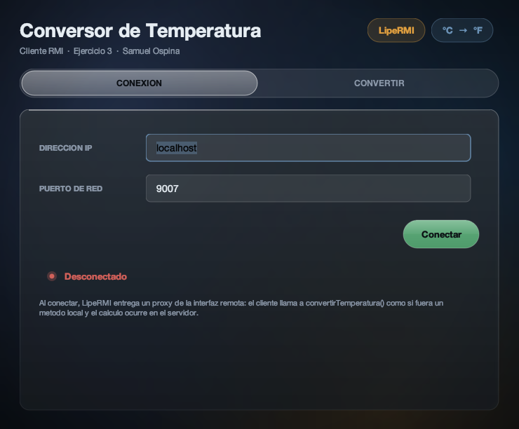
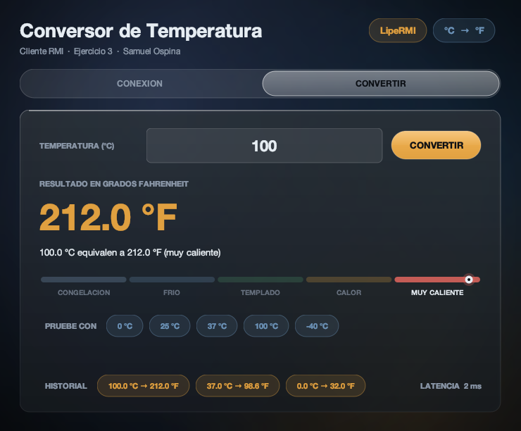
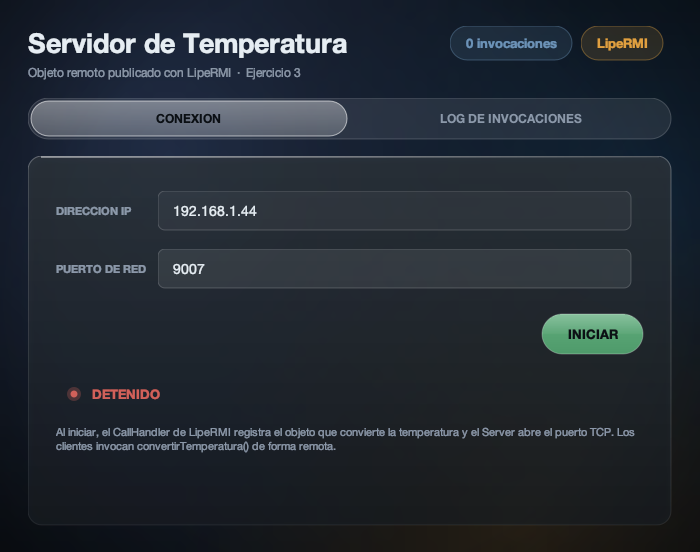
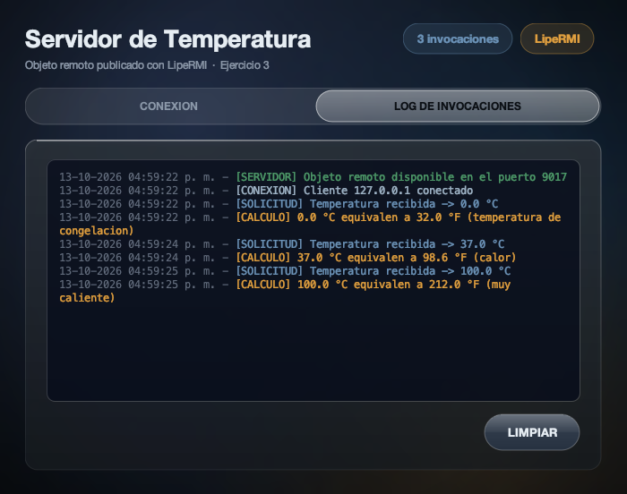

# Ejercicio 3 — Conversión de temperatura con RMI y la librería LipeRMI

Autor: **Samuel David Ospina De Avila**

Materia: Sistemas Distribuidos — profesor John Carlos Arrieta Arrieta

Sistema distribuido cliente–servidor sobre TCP/IP que usa **RMI (Remote Method Invocation)** mediante la librería de terceros **LipeRMI**, siguiendo la guía de clase pero con mi ejercicio de parcial. La versión con RMI estándar de Java (sin librería) está en el repositorio hermano [RMI-Temperatura](https://github.com/SamuelOsp/RMI-Temperatura).

## Vistas

<table>
<tr>
<td width="50%">

**Cliente** — pestaña de conexión



</td>
<td width="50%">

**Cliente** — resultado de la invocación remota



</td>
</tr>
<tr>
<td width="50%">

**Servidor** — pestaña de conexión



</td>
<td width="50%">

**Servidor** — log de invocaciones atendidas



</td>
</tr>
</table>

## El ejercicio

> **Ejercicio 3: Conversión de temperatura.** Desarrolle una aplicación que convierta una
> temperatura expresada en **grados Celsius** a **grados Fahrenheit**. El cliente solicitará
> la temperatura, la enviará al servidor y este realizará la conversión correspondiente. El
> resultado deberá regresar al cliente y mostrarse indicando claramente ambas unidades.

Es el mismo ejercicio que ya resolví con Sockets TCP y con UDP + arquitectura hexagonal. La
fórmula `F = C × 9/5 + 32` vive **únicamente en el servidor**; el cliente valida el dato,
invoca el método remoto y muestra la respuesta.

Son tres proyectos, como en la guía:

| Proyecto | Tipo | Contenido |
|---|---|---|
| `LibTemperatura` | Java Class Library | `DatosTemperatura` (datos serializables) e `IRemotaConversionTemperatura` (interfaz remota). Lo usan los otros dos. |
| `ServidorTcpTemperatura` | Java Application | `ConversionRmiTemperaturaImplem` (la lógica), `Servidor` (publica el objeto remoto) y la ventana con el log. |
| `ClienteTcpTemperatura` | Java Application | Ventana Swing que valida los datos e invoca `convertirTemperatura()` de forma remota. |

## Estructura

```
LipeRMI-Temperatura/
├── LibTemperatura/src/samuelospina/temperatura/rmi/lib/
│   ├── DatosTemperatura.java
│   └── IRemotaConversionTemperatura.java
├── ServidorTcpTemperatura/src/samuelospina/temperatura/
│   ├── Principal.java
│   ├── servidor/ConversionRmiTemperaturaImplem.java
│   ├── servidor/Servidor.java
│   ├── vistas/VentanaPrincipal.java
│   └── vistas/Glass.java
├── ClienteTcpTemperatura/src/samuelospina/temperatura/cliente/
│   ├── Principal.java
│   ├── vistas/VentanaPrincipal.java
│   └── vistas/Glass.java
├── lib/lipermi-1.0.1.jar                         (librería LipeRMI)
└── docs/screenshots/
```

Cada proyecto trae además `build.xml` y `nbproject/` para abrirlo en NetBeans.

## Abrir en NetBeans

1. `File > Open Project` y abrir las tres carpetas: `LibTemperatura`, `ServidorTcpTemperatura` y `ClienteTcpTemperatura`.
2. Clic derecho sobre **LibTemperatura** → *Clean and Build* (genera `LibTemperatura/dist/LibTemperatura.jar`).
3. *Run* sobre **ServidorTcpTemperatura** y luego *Run* sobre **ClienteTcpTemperatura**.

`ServidorTcpTemperatura` y `ClienteTcpTemperatura` tienen a `LibTemperatura` agregado como proyecto (*Libraries > Add Project*), así
que NetBeans lo recompila solo cuando hace falta. NetBeans regenera
`nbproject/build-impl.xml` al abrir cada proyecto.

La librería LipeRMI ya está en `lib/lipermi-1.0.1.jar` y los proyectos la referencian con ruta relativa; se descargó de Maven Central (`com.tascape.qa:lipermi:1.0.1`), como indica la guía.

> Si NetBeans no reconoce algún proyecto, se puede crear con
> `File > New Project > Java with Ant > Java Project with Existing Sources` apuntando a su
> carpeta `src` y agregando los JAR en *Libraries*.

## Compilar y ejecutar por consola

Requiere solo un JDK 8 o superior (probado con JDK 21). Desde la raíz del repositorio:

```bash
# 1. Librería compartida
cd LibTemperatura
javac -encoding UTF-8 -d build/classes $(find src -name "*.java")
mkdir -p dist && jar cf dist/LibTemperatura.jar -C build/classes .

# 2. Servidor
cd ../ServidorTcpTemperatura
javac -encoding UTF-8 -cp "../LibTemperatura/dist/LibTemperatura.jar:../lib/lipermi-1.0.1.jar" -d build/classes $(find src -name "*.java")
java -cp "../LibTemperatura/dist/LibTemperatura.jar:../lib/lipermi-1.0.1.jar:build/classes" samuelospina.temperatura.Principal

# 3. Cliente (en otra terminal)
cd ClienteTcpTemperatura
javac -encoding UTF-8 -cp "../LibTemperatura/dist/LibTemperatura.jar:../lib/lipermi-1.0.1.jar" -d build/classes $(find src -name "*.java")
java -cp "../LibTemperatura/dist/LibTemperatura.jar:../lib/lipermi-1.0.1.jar:build/classes" samuelospina.temperatura.cliente.Principal
```

> En Windows el separador del classpath es `;` en lugar de `:`. El `-encoding UTF-8` importa
> porque los textos usan símbolos como `°`, `·` y `²`.

## Cómo probar

1. Ejecutar el **Servidor**, pestaña CONEXION, puerto `9007`, botón **INICIAR** (el estado
   pasa a ONLINE y la ventana salta al log).
2. Ejecutar el **Cliente**, IP `localhost` (o la IP que muestra el servidor, si está en otro
   computador de la red), puerto `9007`, botón **Conectar**.
3. En la pestaña **CONVERTIR** escribir la temperatura en °C y pulsar **CONVERTIR** (o Enter).
4. El resultado en °F aparece en el cliente, con el medidor y el historial, y la traza de la
   invocación queda en la pestaña **LOG DE INVOCACIONES** del servidor.

| Entrada (°C) | Resultado (°F) | Clasificación |
|---|---|---|
| `0` | `32.0` | temperatura de congelación |
| `37` | `98.6` | calor |
| `100` | `212.0` | muy caliente |
| `-40` | `-40.0` | el único punto donde ambas escalas coinciden |
| `-300` | rechazado | está por debajo del cero absoluto |

## Validación y control de errores

En el **cliente**, antes de invocar al servidor: campo vacío, texto no numérico (se acepta
coma o punto decimal), temperatura menor a `-273.15 °C`, puerto no numérico, e intento de
convertir sin conexión ("Cliente OffLine, Conecte con el Servidor"). Si la invocación falla
porque el servidor se cayó, el cliente avisa y vuelve a "Desconectado" sin cerrarse.

En el **servidor**, `ConversionRmiTemperaturaImplem` vuelve a validar el cero absoluto: nunca
se confía solo en la validación del cliente.

## Interfaz

Las dos ventanas usan mi kit visual `vistas/Glass.java` (material translúcido tipo *Liquid
Glass*, pintado a mano con Java2D y sin librerías externas), el mismo de la entrega con
Sockets TCP. Para esta entrega el kit creció con:

- **`Glass.Medidor`**: escala por tramos con un marcador animado que se desliza hasta el
  resultado e ilumina el tramo que corresponde.
- **`Glass.Bitacora`**: consola del servidor que colorea cada línea según su etiqueta
  (`[SERVIDOR]`, `[CONEXION]`, `[SOLICITUD]`, `[CALCULO]`, `[ERROR]`).
- **Historial** de las últimas invocaciones y **latencia** en milisegundos de la llamada
  remota en el cliente; **contador de invocaciones** atendidas en el servidor.
- El servidor muestra la IPv4 de la red local (no `127.0.0.1`), que es la que debe escribir
  un cliente en otro computador.

## RMI estándar vs LipeRMI: diferencias y similitudes

| | RMI estándar (Java SE) | LipeRMI |
|---|---|---|
| Dependencias | Ninguna: viene en el JDK (`java.rmi`) | `lipermi-1.0.1.jar` en cliente y servidor |
| Interfaz remota | Debe extender `java.rmi.Remote` | Interfaz Java común |
| Métodos remotos | Cada uno declara `throws RemoteException` | Sin excepciones obligatorias |
| Implementación | Extiende `UnicastRemoteObject`; el constructor declara `RemoteException` | Clase común (POJO) que implementa la interfaz |
| Publicar en el servidor | `LocateRegistry.createRegistry(puerto)` + `registro.rebind(nombre, objeto)` | `CallHandler.registerGlobal(Interfaz.class, objeto)` + `Server.bind(puerto, handler)` |
| Cómo lo encuentra el cliente | Por **nombre** en el registro: `LocateRegistry.getRegistry(ip, puerto).lookup(nombre)` | Por **tipo**: `new Client(ip, puerto, handler).getGlobal(Interfaz.class)` |
| Conexión | No hay conexión visible: el stub abre y reutiliza sockets por su cuenta | Un socket TCP persistente por cliente, que se abre y se cierra explícitamente |
| Detener el servidor | `unbind` + `unexportObject` del objeto y del registro | `Server.close()` (ver nota abajo) |
| Dirección del servidor | Viaja dentro del stub (`java.rmi.server.hostname`) | El cliente usa la IP y el puerto que escribió |
| Errores de red en el cliente | `RemoteException` comprobada | Excepción no comprobada lanzada por el proxy |

**Similitudes:** en los dos casos el cliente llama a un método sobre un *proxy* de la interfaz
como si el objeto fuera local; los parámetros y el resultado deben ser `Serializable` y viajan
por valor sobre TCP; la interfaz y la clase de datos se comparten entre cliente y servidor
mediante el mismo JAR de librería; y el cálculo se ejecuta únicamente en el servidor.

## Nota sobre `Server.close()` de LipeRMI

Al probar el botón **DETENER** encontré que `Server.close()` de LipeRMI 1.0.1 solo baja una
bandera interna: el hilo de escucha sigue bloqueado en `accept()` y el `ServerSocket` nunca se
cierra. El puerto quedaba ocupado (no se podía volver a INICIAR) y los clientes ya conectados
seguían siendo atendidos con el servidor "detenido". `Servidor.detener()` completa la parada:
despierta al hilo de escucha con una conexión local, cierra el `ServerSocket` de la librería
y corta las conexiones abiertas. Con eso se puede detener y volver a iniciar en el mismo
puerto, y el cliente pasa solo a "Desconectado".
